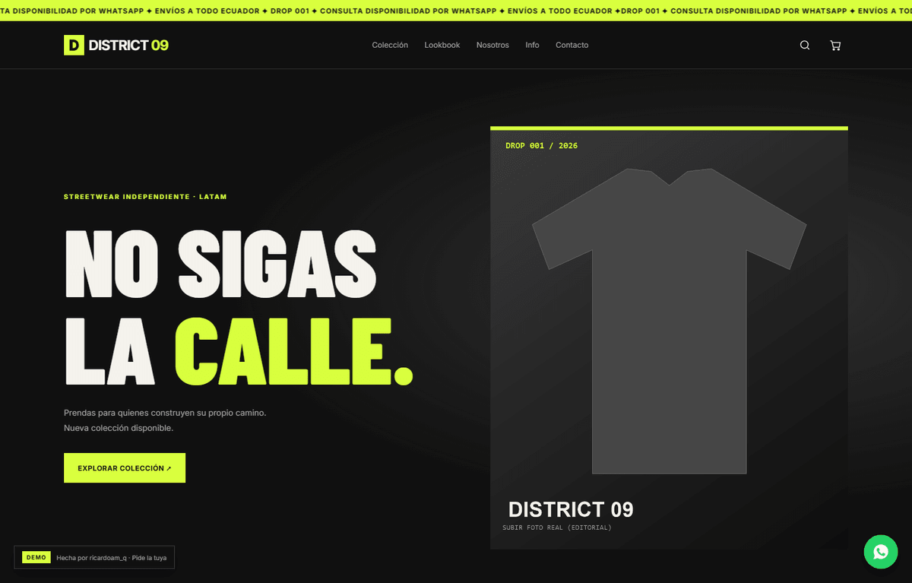
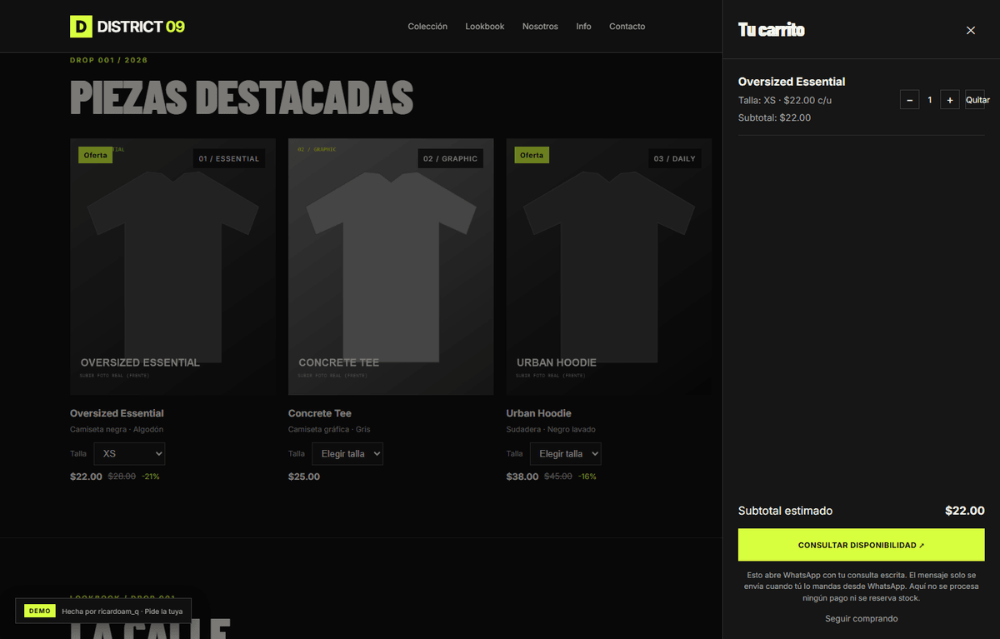
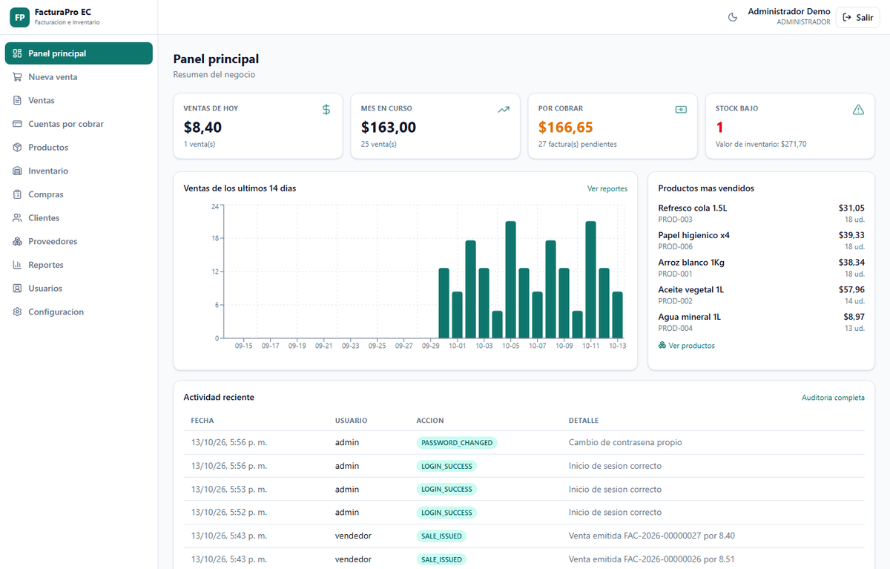
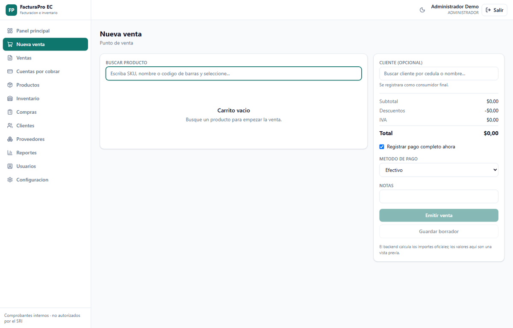



  

 

  

 

---

## 👋 Sobre mí · About me

Soy **Ricardo Andrés Muñoz Quimi**, estudiante de **Ingeniería en Computación** en la Universidad Politécnica Salesiana, sede Guayaquil. Me oriento al desarrollo **full stack**: trabajo con **Java y Spring Boot** en el backend y con **React + TypeScript** en el frontend, y sigo formándome en cada proyecto.

Entre **junio y agosto de 2026** fui **docente tutor** en la misma universidad, apoyando materias de programación (Python, PSeInt), algoritmos, lógica y áreas matemáticas.

🔎 **Busco oportunidades laborales en tecnología** para seguir aprendiendo y aportar valor en un equipo de desarrollo.

> 🇬🇧 I'm **Ricardo Andrés Muñoz Quimi**, a **Computer Engineering** student at Universidad Politécnica Salesiana (Guayaquil, Ecuador). I'm oriented towards **full-stack** development: **Java + Spring Boot** on the backend and **React + TypeScript** on the frontend, and I keep learning with every project.
>
> Between **June and August 2026** I worked as a **teaching tutor** at the same university, supporting courses on programming (Python, PSeInt), algorithms, logic and maths.
>
> 🔎 **I'm looking for tech opportunities** to keep learning and contribute to a development team.

---

## 🎯 Perfil técnico · Technical profile

- **Enfoque:** backend con Java/Spring Boot y frontend con React/TypeScript.
- **Intereses:** APIs REST, seguridad básica, bases de datos y buenas prácticas de código.
- **Experiencia académica:** docente tutor (jun–ago 2026).
- **Formación:** Ingeniería en Computación — estudiante universitario, aún no graduado.
- **Idiomas:** español nativo · inglés B1.

> 🇬🇧 **Focus:** Java/Spring Boot backend + React/TypeScript frontend. **Interests:** REST APIs, basic security, databases and clean-code practices. **Academic experience:** teaching tutor (Jun–Aug 2026). **Status:** university student, not yet graduated. **Languages:** native Spanish · English B1.

---

## 🛠️ Tecnologías y herramientas · Technologies & tools

**En mis proyectos · Used in my projects**

**Herramientas · Tools**

**También conozco / también estoy aprendiendo:**
`SQL Server` · `Node.js` · `C/C++` · `Excel` · `Power BI` · `TCP/IP` · `VLAN` · `Cisco Packet Tracer` · `Arquitectura de computadores` · `Fundamentos de hardware` · `PSeInt`

> 🇬🇧 Not every tool above is used at the same level: some come from university courses and tutor sessions, others from my own projects. I describe them as **knowledge and learning**, not as professional mastery.

---

## 📊 GitHub Stats · Estadísticas

<table>
  <tr>
    <td></td>
    <td></td>
  </tr>
  <tr>
    <td></td>
    <td></td>
  </tr>
</table>

---

## 🚀 Proyectos destacados · Featured projects

### 🛍️ DISTRICT 09 — catálogo streetwear con demo pública

Demo de tienda **100% estática** (sin backend): catálogo de productos, búsqueda, detalle de prenda, carrito persistente con `localStorage` y preparación de pedido por WhatsApp. Pensada como demo de producto para marcas de ropa independientes.

**Stack:** HTML semántico · CSS puro (variables, animaciones, responsive) · JavaScript vanilla · CSP · sin dependencias

**Destacados:**
- Catálogo validado con búsqueda, detalle de producto y tallas por prenda
- Carrito persistente (`localStorage`) que prepara el pedido en WhatsApp
- Cabeceras de seguridad (CSP) para Netlify, Cloudflare Pages y Vercel
- Responsive, animaciones de entrada y soporte de `prefers-reduced-motion`
- **Limitación conocida:** no muestra stock ni estados “agotado”; la disponibilidad se consulta por WhatsApp

> 🇬🇧 A fully **static storefront demo** (no backend): catalog, search, product details, a `localStorage` cart and WhatsApp order hand-off. Security headers (CSP), responsive layout and reduced-motion support. **Known limitation:** no stock states — availability is confirmed over WhatsApp.

 

  
  

---

### 🧾 FacturaPro EC — facturación e inventario (Spring Boot + React)

Sistema de facturación e inventario para negocios ecuatorianos: punto de venta, compras, cuentas por cobrar, control de existencias, reportes y auditoría. API en **Spring Boot** + frontend **React con TypeScript**; se ejecuta en local con MySQL 8.4.

**Stack:** Java 21 · Spring Boot 3 · Spring Security · Spring Data JPA · Flyway · MySQL 8 · React 19 · TypeScript · Vite · Tailwind CSS

**Destacados:**
- Roles y permisos aplicados en el backend (`@PreAuthorize`), sesión con CSRF y bloqueo tras intentos fallidos
- Punto de venta con importes calculados por el backend, numeración secuencial por año y comprobantes en PDF
- Inventario transaccional con movimientos trazables y registro de auditoría
- Reportes de ventas, impuestos e inventario con exportación a CSV, más panel con indicadores
- **Importante:** los comprobantes son **internos**, no autorizados electrónicamente por el SRI; **no hay demo pública** (proyecto en desarrollo local)

> 🇬🇧 An **invoicing and inventory system** for Ecuadorian businesses: POS, purchases, receivables, stock control, reports and audit trail, with a **Spring Boot** API and a **React + TypeScript** frontend. Backend-enforced roles, CSRF-protected sessions, PDF internal invoices, transactional inventory and CSV reports. **Invoices are internal (not SRI-authorized)** and there is **no public demo** yet — the project runs locally.

 

  
  

---

## 🏆 Hackathon universitaria · procesamiento de transacciones bancarias

Participé con mi equipo en una **hackathon universitaria** de procesamiento de transacciones bancarias y quedamos entre los **10 finalistas**.

El reto combinó ingesta y procesamiento de archivos **CSV**, un backend en **Spring Boot**, persistencia en **SQL** y una interfaz **React**. Es un trabajo académico: **no hay demo pública ni repositorio público** que enlazar.

> 🇬🇧 My team joined a **university hackathon** on bank transaction processing and reached the **top 10 finalists**. The challenge combined **CSV** file ingestion, a **Spring Boot** backend, **SQL** persistence and a **React** interface. It is academic work: **there is no public demo or repository** to link.

---

## 📫 Contacto · Contact

---

## 🌟 Mensaje de cierre · Closing note

Gracias por pasar y revisar mi trabajo. Si algo de lo que ves encaja con lo que buscas, escríbeme: siempre estoy dispuesto a seguir aprendiendo.

> 🇬🇧 Thanks for stopping by and looking at my work. If anything here matches what you're looking for, write to me — I'm always ready to keep learning.
